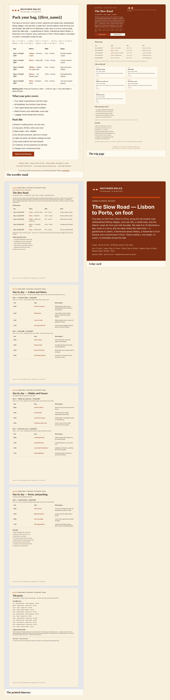
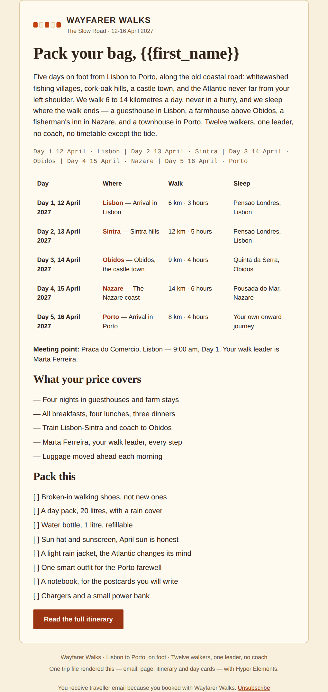
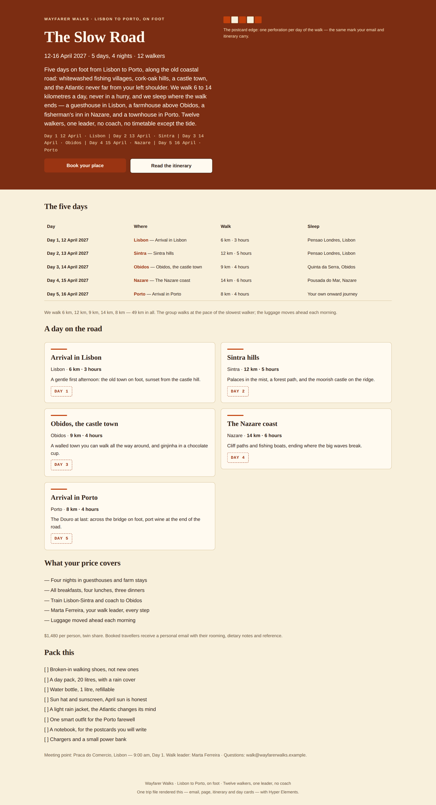
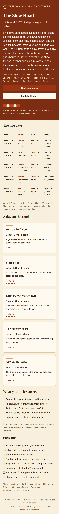
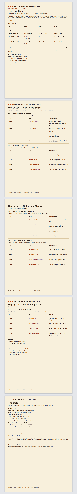
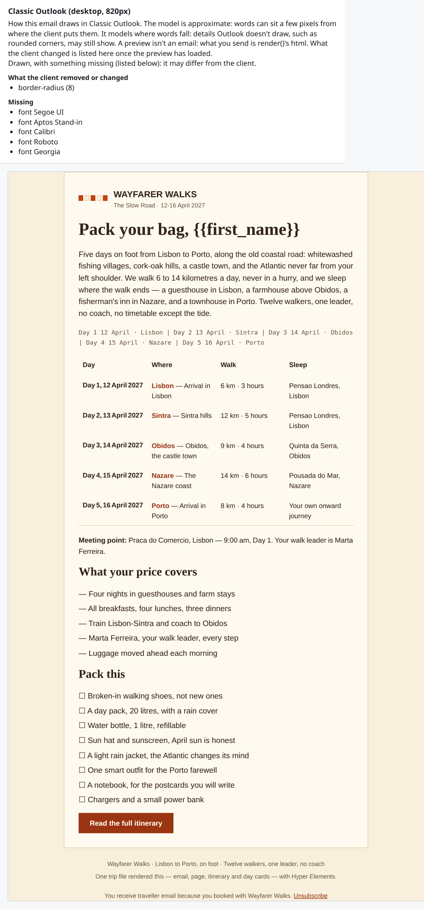
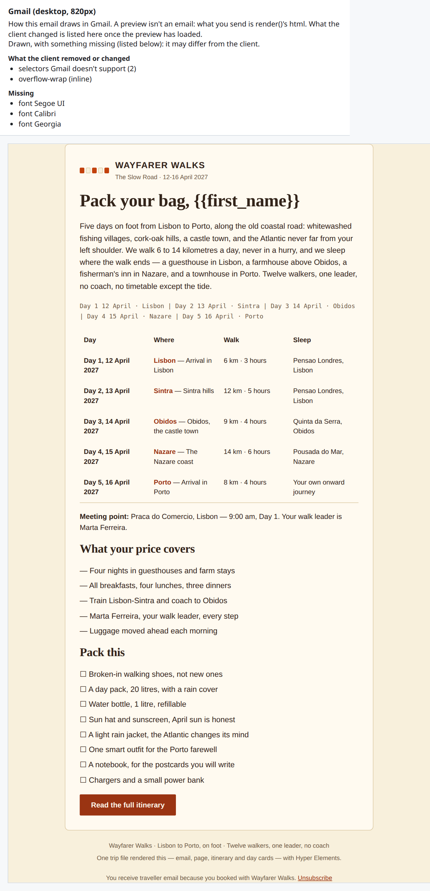

# WAYFARER — The Slow Road, walked

A Hyper Elements template kit for a small-group walking trip. **One
trip file** (`src/data/trip.ts`) renders everything a walking trip
needs — the traveller email, the public trip page, the printed
itinerary as a real PDF, and the daily social cards — from **one
theme** and **one set of shared components**.



*Every screenshot in this README is a photograph of a real render
(`npm run render` + `npm run shots`): if it is pictured, it was rendered.*

**Measured on the demo run (20 Nov 2026):** one trip file → **12
personalised traveller emails**, a **5-page printed itinerary** (one
A4 itinerary PDF), **6 day cards** (one per day plus the cover card)
— gate at **0 errors, 0 warnings**, batch in **2.3s**. Reproduce it:
`npm run check && npm run make`, then read `out/checks.json` and
`out/batch.json`.

| The email (600px) | The page (desktop) | The page (mobile) |
|---|---|---|
|  |  |  |

| The printed itinerary (A4) | The email in Outlook | The email in Gmail |
|---|---|---|
|  |  |  |

The day card PNG itself is in
[`examples/day-card.png`](examples/day-card.png).

## Why a postcard?

A trip's paperwork fails in a predictable way: the email says one
thing, the website another, and the itinerary in the walker's hands
says a third — a different meeting time, a different distance, a
traveller's rooming spelled two ways. This kit makes that impossible
by construction. Every date, distance and name lives in **one trip
file**; the email quotes it, the page's cards carry it, and the
printed itinerary prints it next to the leader's note. The
**PostcardStrip** — one perforation per day of the walk, burnt orange
and cream alternating — is the trip drawn as a postcard edge, and it
is built from a `Row` of fixed-width `Column`s so it survives in an
inbox that blocks images and in a PDF that never loads one.

## The four outputs

| Output | Root | Script | What it is |
|---|---|---|---|
| Traveller email | `Email` → `render()` | `templates/traveller-email.tsx` | The five days lead, day + inclusions + packing lists, a MergeTag greeting, plain-text twin from the same render |
| Trip page | `Page` → `render()` | `templates/trip-page.tsx` | Rust hero, every day as a typed `trip.DayCard`, phone styles, no client-side JavaScript |
| Printed itinerary | `Document` → `renderPdf()` | `templates/itinerary-document.tsx` | Five A4 pages — the trip (days, price, inclusions), the road day by day with every stop, packing and the traveller roster, `PageHeader`/`PageFooter` with `PageNumber` |
| Day cards | `Canvas` → `renderImage()` | `templates/day-canvas.tsx` | 1080×1080 PNGs — one per day, led by that day in poster type, plus the trip cover card |

## Run it

```bash
npm install
npm run check        # validate() gate: core + lint + email-clients -> out/checks.json
npm run render       # one of each output -> out/
npm run clients      # the email as Outlook / Gmail / Apple Mail draw it -> out/clients/
npm run make         # 12 traveller emails + itinerary PDF + 6 day cards -> out/travellers/, out/batch.json
npm run make:sample  # 6 emails, for a quick look
npm run shots        # screenshots of the real outputs -> docs/
```

Node 20+. `examples/` holds one artefact of each kind.

## The trip

The Slow Road — Lisbon to Porto, on foot, 12–16 April 2027. Five
days, 49 km, twelve walkers, one leader (Marta Ferreira). Lisbon,
Sintra hills, Obidos, the Nazare coast, Porto. The data file is the
whole product: change the days, the stops, the travellers, and every
output follows, because every output reads the same file.

## Design

Postcard editorial: warm cream `#f8f0dc`, ink brown `#33241a`,
burnt orange `#9a3412` for text and `#c2410c` for shapes only, deep
rust `#7c2d12` for the hero, a serif display face (Georgia in
Email/Page, Times in the Document) against an Inter body. See
[`docs/design.md`](docs/design.md) for the notes and the build
lessons, including the one that cost a page: a Document page clips
what does not fit, it never flows it on.
